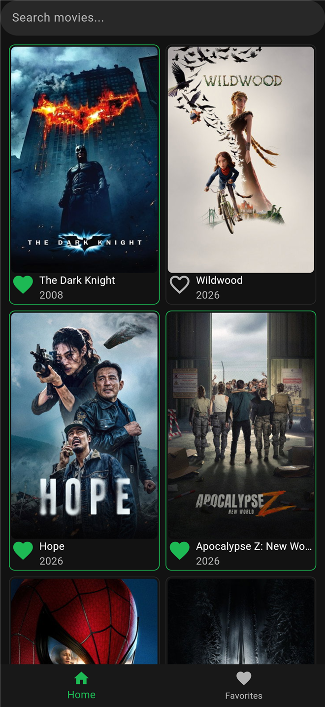
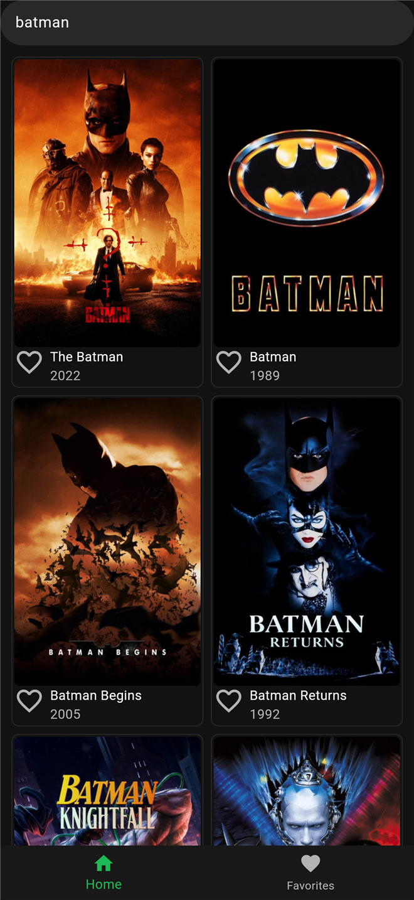
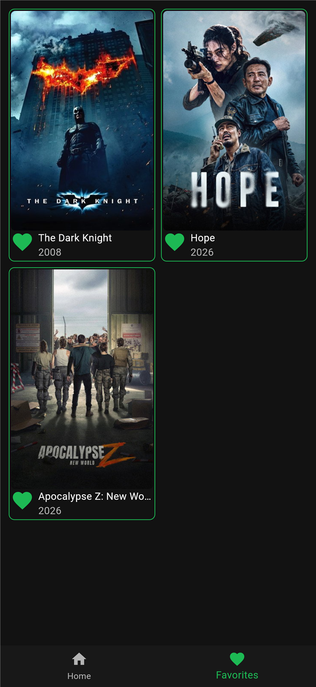
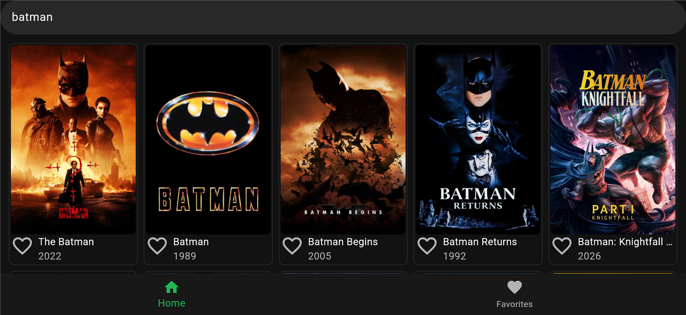

# Movie App (Flutter)

Browse popular movies, search the TMDB catalog, and keep a list of favorites.
Built with Flutter and Riverpod, with the API layer injected through a provider so it can be replaced by a fake in tests.

| Home | Search | Favorites |
|---|---|---|
|  |  |  |

The grid adapts to the screen width (landscape):



## Features

- Popular movies from [TMDB](https://www.themoviedb.org/)
- Search (press Enter; an empty search returns to popular)
- Three independent lists: Favorites, Watchlist, Watched. Mark a movie from its card, see each list in its own tab. Saved on the device (`shared_preferences`), so they survive a restart
- Hebrew / English movie titles: a button next to the search field switches the TMDB language and refetches
- Loading and error states
- Dark theme with a single accent color ([DESIGN_SYSTEM.md](DESIGN_SYSTEM.md))

## Tech

Flutter · Dart · [Riverpod 3](https://riverpod.dev/) · `http` · `shared_preferences` · TMDB REST API

## How it is built

```
UI        screens/ + widgets/      ConsumerWidget, reads providers with ref.watch
State     providers/               favorites, search text, language (Notifier), movies (FutureProvider)
Service   services/movie_api.dart  MovieApi: HTTP + JSON -> Movie
```

- **No prop drilling.** The movie card and the list screens read straight from the list providers.
- **One class, three lists.** `MovieListNotifier` takes a storage key, and `favoritesProvider`, `watchlistProvider` and `watchedProvider` are three instances of it.
- **Movies follow the search text and language.** `moviesProvider` watches `searchQueryProvider` and `languageProvider`, so a new search or language refetches by itself.
- **Dependency injection.** `moviesProvider` does not create `MovieApi`. It gets it from `movieApiProvider`. In tests the provider is overridden with `FakeMovieApi`, so tests run without network and with known data.

```dart
final container = ProviderContainer(
  overrides: [movieApiProvider.overrideWithValue(FakeMovieApi())],
);
```

## Run it

1. Get a free API key at [themoviedb.org](https://www.themoviedb.org/settings/api).
2. Create `env.json` in the project root (it is in `.gitignore`, the key never goes to git):
   ```json
   { "TMDB_KEY": "your_key_here" }
   ```
3. Run:
   ```bash
   flutter pub get
   flutter run -d chrome --dart-define-from-file=env.json
   ```

## Tests

```bash
flutter test
```

- `test/movies_provider_test.dart` checks that `moviesProvider` uses the injected API, with a fake that returns fixed movies.
- `test/movie_model_test.dart` checks that `Movie.fromJson` reads TV fields (`name`).

## Project structure

```
lib/
  main.dart                 ProviderScope, theme, bottom navigation
  models/movie.dart         Movie + fromJson
  services/movie_api.dart   MovieApi (TMDB calls)
  providers/                favorites, search, movies, movieApi, language, storage
  screens/                  home_screen, movie_list_screen
  widgets/                  movie_card, movie_grid
  theme/app_theme.dart      colors and ThemeData
test/                       movie_model_test, movies_provider_test
```
